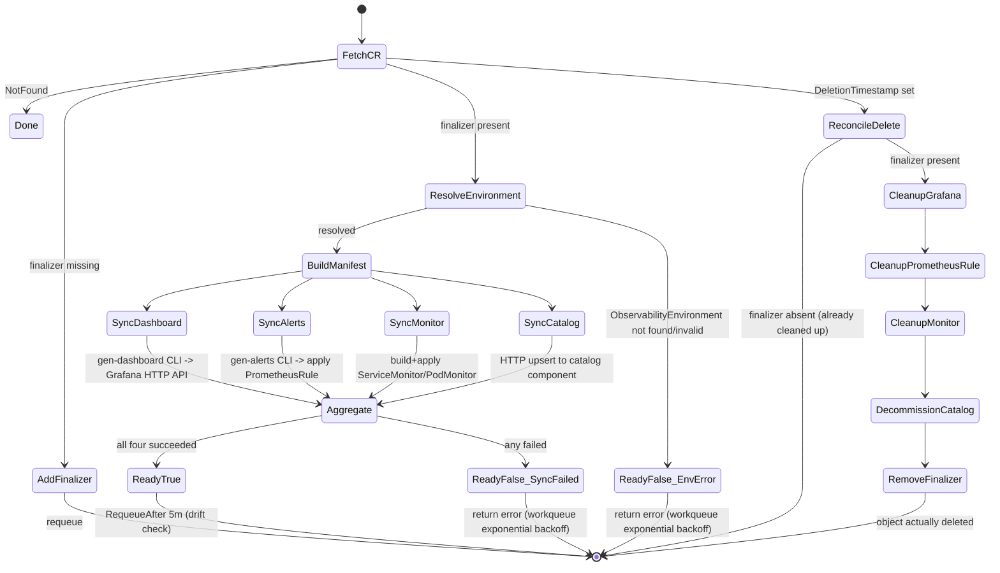

# obs-onboarding-controller

Sistemin orkestrasyon merkezi. Servis repolarındaki `observability.yaml`
manifestlerinin Kubernetes-native karşılığı olan `ServiceObservability` CR'sini
izler ve onu gerçek Grafana dashboard'larına, Prometheus/Alertmanager
kurallarına, `ServiceMonitor`/`PodMonitor` kayıtlarına ve bir servis-katalog
kaydına dönüştürür. `obs-golden-signal-templates` (gen-dashboard) ve
`obs-alert-rule-templates` (gen-alerts) CLI'larını çağırır; Grafana HTTP
API'sine gerçek istekler atar; Prometheus/Alertmanager'a hiçbir zaman doğrudan
konuşmaz -- yalnızca Prometheus Operator'ün izlediği CR'leri (`PrometheusRule`,
`ServiceMonitor`, `PodMonitor`) apply eder.

## İçindekiler

1. [CRD şeması](#1-crd-şeması)
2. [Reconciler state machine](#2-reconciler-state-machine)
3. [Idempotency ve drift detection](#3-idempotency-ve-drift-detection)
4. [Hata durumları ve retry](#4-hata-durumları-ve-retry)
5. [Multi-cluster / multi-environment: environment overlay](#5-multi-cluster--multi-environment-environment-overlay)
6. [Meta-monitoring / dogfooding](#6-meta-monitoring--dogfooding)
7. [Güvenlik / secret yönetimi](#7-güvenlik--secret-yönetimi)
8. [Testler](#8-testler)
9. [Helm chart / dağıtım](#9-helm-chart--dağıtım)
10. [Mimari kararlar ve trade-off'lar](#10-mimari-kararlar-ve-trade-offlar)

## 1. CRD şeması

İki CRD var:

- **`ServiceObservability`** (namespaced) -- [api/v1/serviceobservability_types.go](api/v1/serviceobservability_types.go).
  `obs-manifest-schema`'nın v2 şemasının (`slo`, `goldenSignals`, `dashboards`,
  `alerting`, `ownership`) Kubernetes-native, kubebuilder marker'larıyla
  doğrulanan karşılığı, artı operatöre özgü `scrapeConfig` alanı
  (`ServiceMonitor`/`PodMonitor` üretimini tetikler).
- **`ObservabilityEnvironment`** (cluster-scoped) -- [api/v1/observabilityenvironment_types.go](api/v1/observabilityenvironment_types.go).
  "Environment overlay" mekanizması: Grafana instance'ı, Prometheus rule
  namespace'i, catalog endpoint'i ve bunların secret referanslarını taşır.
  Bkz. [§5](#5-multi-cluster--multi-environment-environment-overlay).

`ServiceObservability.spec.environment` bir `ObservabilityEnvironment`
objesinin **adına** referans verir (`dev`/`staging`/`prod`); reconciler bu adla
`Get` yaparak o environment'ın Grafana/Prometheus/catalog ayarlarını çözer.

`ServiceObservability.status.conditions` beş bağımsız `Condition` taşır:
`Ready`, `DashboardSynced`, `AlertsSynced`, `ServiceMonitorSynced`,
`CatalogSynced` -- her biri kendi başarısını/hatasını taşır, tek bir
`Ready` boolean'ında kaybolmaz (bkz. [§4](#4-hata-durumları-ve-retry)).

## 2. Reconciler state machine



Adım adım (kod: [internal/controller/serviceobservability_controller.go](internal/controller/serviceobservability_controller.go)):

1. **Fetch** -- CR bulunamazsa (zaten silinmiş) sessizce çık.
2. **Delete dalı** -- `DeletionTimestamp` set edilmişse `reconcileDelete`'e dallan (adım 9-13).
3. **Finalizer ekle** -- yoksa ekle, `Update` et, `Requeue: true` dön. Bu, silme
   isteğinin cluster'a hard-delete olarak gitmeden önce operatörün Grafana/
   PrometheusRule/catalog temizliğini garantiye alan standart K8s idiyomudur.
4. **Environment çöz** -- `spec.environment` adıyla `ObservabilityEnvironment`
   `Get` edilir. Bulunamazsa/geçersizse `Ready=False, reason=EnvironmentUnresolved`
   yazılır ve hata dönülür.
5. **Manifest inşa et** -- CR spec'i `obs-manifest-schema` v2 YAML'ına
   ([internal/manifestbuild](internal/manifestbuild)) çevrilir; bu bytes hem
   `gen-dashboard` hem `gen-alerts`'e aynen geçer.
6. **syncDashboard** -- `gen-dashboard` CLI'ı çalıştırılır
   ([internal/gentools](internal/gentools)), çıktıdaki dashboard JSON'una
   sabit bir `uid` (`<service>-<environment>`) basılır (aksi halde Grafana her
   çağrıda yeni rastgele bir UID üretir ve idempotency kırılır), sonra gerçek
   Grafana HTTP API'sine (`EnsureFolder` + `POST /api/dashboards/db`) push
   edilir ([internal/grafana](internal/grafana)).
7. **syncAlerts** -- `gen-alerts` CLI'ı çalıştırılır, çıktı YAML'ı
   `monitoringv1.PrometheusRule`'a decode edilir ve cluster'a apply edilir
   ([internal/promsync](internal/promsync)) -- Prometheus Operator bunu
   otomatik pick-up eder, bu operatör Prometheus'a hiç konuşmaz.
8. **syncMonitor** -- `spec.scrapeConfig` set edilmişse `ServiceMonitor` (veya
   `podMonitor: true` ise `PodMonitor`) inşa edilip apply edilir.
9. **syncCatalog** -- `internal/catalogclient` ile catalog REST API'sine
   (`internal/catalog`, `cmd/catalog`) gerçek bir `POST /v1/services` atılır.
10. **Aggregate** -- dört adımdan biri bile hata verirse `Ready=False`,
    hepsi başarılıysa `Ready=True`; her adımın kendi Condition'ı bağımsız
    kalır (bkz. [§4](#4-hata-durumları-ve-retry)).
11. **Silme: cleanup** -- environment hâlâ çözülebiliyorsa sırasıyla Grafana'dan
    dashboard silinir, `PrometheusRule` silinir, `ServiceMonitor`/`PodMonitor`
    silinir, catalog kaydı **hard delete değil, `decommissioned`** olarak
    işaretlenir (audit trail için, requirement 2g).
12. **Environment de silinmişse** -- dış sistemlere artık konuşacak bir
    hedef yoktur; bu durum loglanır ve finalizer yine de kaldırılır, CR
    sonsuza dek "stuck" kalmaz.
13. **RemoveFinalizer** -- K8s objeyi gerçekten siler.

## 3. Idempotency ve drift detection

- **Idempotency**: dashboard UID'i sabitlendiği için `UpsertDashboard`
  overwrite eder, çoğaltmaz; `PrometheusRule`/`ServiceMonitor`/`PodMonitor`
  `controllerutil.CreateOrUpdate` ile create-or-patch edilir; catalog `Upsert`
  zaten idempotent bir REST semantiğidir.
- **Drift detection**: her başarılı reconcile `RequeueAfter: 5m` döner
  (`driftCheckInterval`, [internal/controller/serviceobservability_controller.go](internal/controller/serviceobservability_controller.go)).
  Yani biri Grafana'da dashboard'ı elle silse veya `PrometheusRule`'u
  `kubectl delete` etse, en geç 5 dakika içinde bir sonraki reconcile bunu
  yeniden oluşturur -- GitOps'un "sürekli reconcile" ilkesi. CR değişikliği
  (create/update/delete) ayrıca controller-runtime'ın watch mekanizmasıyla
  aninda tetiklenir; 5 dakikalık requeue sadece CR *değişmeden* oluşan drift'i
  yakalamak içindir.

## 4. Hata durumları ve retry

Dört senkronizasyon adımı **bağımsızdır**: Grafana geçici olarak
erişilemezken bile `PrometheusRule` ve catalog kaydı senkronize olmaya devam
eder (bkz. testteki "Grafana 5xx" senaryosu). Her adım kendi
`status.conditions[]` girdisini yazar (`DashboardSynced`, `AlertsSynced`, ...),
`reason` alanı hatanın türünü ayırt eder:

- `GrafanaTemporarilyUnavailable` / `CatalogTemporarilyUnavailable` -- 5xx/429,
  yeniden denenebilir (`grafana.APIError.Retryable()`).
- `GrafanaRequestRejected` / `CatalogRequestRejected` -- diğer 4xx, muhtemelen
  manifest/config hatası (retry etmek düzeltmez, ama yine de dener -- kalıcı
  hatalar için ayrı bir "tükendi" durumu bu reponun kapsamı dışında).
- `RenderFailed` -- `gen-dashboard`/`gen-alerts` CLI'ı hata döndü (genelde
  zaten `obs-manifest-schema` CI'ında yakalanmış olması beklenen bir manifest
  hatası, ama runtime'da da savunulur).

Reconcile fonksiyonu bu hatalardan herhangi birini `error` olarak döndürür;
**exponential backoff'u kendimiz implemente etmeyiz** -- controller-runtime'ın
altındaki client-go workqueue (`DefaultControllerRateLimiter`) `Reconcile`
`error` döndüğü her seferde otomatik olarak artan bir gecikmeyle yeniden
kuyruklar (varsayılan: 5ms'den 1000s'ye katlanarak). Başarılı bir reconcile bu
sayacı sıfırlar. Bu, Kubernetes operatör ekosisteminin standart retry
mekanizmasıdır; elle bir `time.Sleep`/retry-loop yazmak bunu yeniden icat
etmek ve muhtemelen daha kötü yapmak olurdu.

## 5. Multi-cluster / multi-environment: environment overlay

Aynı `ServiceObservability` manifesti dev/staging/prod'a **değişmeden**
uygulanabilir; ortama özgü olan her şey (`ObservabilityEnvironment`
[api/v1/observabilityenvironment_types.go](api/v1/observabilityenvironment_types.go)) ayrı bir objede yaşar:

```yaml
apiVersion: obs.acme.com/v1
kind: ObservabilityEnvironment
metadata:
  name: prod   # ServiceObservability.spec.environment: prod buna referans verir
spec:
  grafana:
    url: https://grafana.prod.acme.internal
    apiTokenSecretRef: {name: grafana-prod-api-token, key: token}
  prometheus:
    ruleNamespace: obs-system
    additionalLabels: {release: kube-prometheus-stack}
  catalog:
    url: http://obs-catalog.obs-system.svc:8080
```

**Multi-cluster** için bu repo tek bir gerçek varsayım yapar: **operatörün
her instance'ı tek bir cluster'ı reconcile eder** (standart K8s operatör
modeli -- bir CR'nin `spec.environment`'ı hangi Grafana/Prometheus'a
gideceğini seçer, ama hedef Prometheus/Alertmanager her zaman *bu*
operatörün çalıştığı cluster'daki Prometheus Operator'dur). Gerçek
çoklu-cluster (örn. dev cluster'daki bir manifestin prod cluster'a da
uygulanması) bu deponun kapsamı dışındadır ve iki gerçekçi yol vardır:

1. Her cluster'da bu operatörün kendi instance'ını çalıştırmak (Helm chart
   zaten bunun için tasarlı) ve `obs-gitops-pipelines`'ın aynı
   `ServiceObservability` manifestini her cluster'ın API server'ına ayrı ayrı
   apply etmesi -- Argo CD/Flux'ın "ApplicationSet" desenine benzer.
2. Bu operatörün fleet-mode bir varyantı (çoklu `rest.Config`/kubeconfig ile
   birden fazla cluster'ı aynı process'ten reconcile eden bir "hub-spoke"
   controller) -- bu, bu reponun kapsamına dahil edilmemiştir çünkü
   controller-runtime'ın tek-cluster varsayımını kırar ve kendi başına ayrı
   bir tasarım gerektirir; dürüstçe burada "yapılmadı" olarak işaretliyoruz.

## 6. Meta-monitoring / dogfooding

Operatörün kendi golden signal'ları
([internal/controller/metrics.go](internal/controller/metrics.go)) standart
bir Prometheus `/metrics` endpoint'inde yayınlanır:

- `obs_onboarding_reconcile_duration_seconds{outcome}` -- reconcile süresi (histogram).
- `obs_onboarding_reconcile_errors_total{aspect}` -- hangi adımın (`dashboard`,
  `alerts`, `monitor`, `catalog`, `environment`, `manifest`) hata verdiği.
- `obs_onboarding_services_ready{namespace,name,environment}` -- her CR'nin
  anlık Ready durumu.
- `workqueue_depth`, `workqueue_adds_total`, ... -- controller-runtime'ın
  zaten kayıt ettiği kuyruk derinliği metrikleri (requirement'taki "kuyruk
  derinliği").

Bu metrikler, sistemin geri kalanının tam olarak izlediği türden bir
`ServiceObservability` manifesti ile izlenir:
[config/samples/obs_v1_serviceobservability_self.yaml](config/samples/obs_v1_serviceobservability_self.yaml).
Operatör kendini kendi CRD'siyle onboard eder -- aynı burn-rate/latency-SLO/
saturation alert şablonları, aynı Grafana dashboard pipeline'ı, aynı catalog
kaydı. `charts/obs-onboarding-controller/templates/servicemonitor.yaml`
(`metrics.serviceMonitor.enabled`), bu self-manifest henüz apply
edilmemişken (chicken-and-egg bootstrap dönemi) manuel bir `ServiceMonitor`
sağlar; self-manifest apply edildikten sonra gereksiz hale gelir.

## 7. Güvenlik / secret yönetimi

Operatör **hiçbir zaman** Vault/External Secrets Operator ile doğrudan
konuşmaz. `ObservabilityEnvironment.spec.grafana.apiTokenSecretRef` gibi
referanslar sadece bir `core/v1 Secret`'in `namespace/name/key`'ini taşır
([internal/envresolve](internal/envresolve)); o Secret'ı kimin doldurduğu
(bir insan `kubectl create secret` ile, ya da External Secrets Operator
Vault'tan senkronize ederek) operatör için görünmezdir. Örnek:
[examples/external-secret-grafana-token.yaml](examples/external-secret-grafana-token.yaml)
Vault -> ESO -> Secret -> bu operatör zincirini gösterir. Hardcode edilmiş
hiçbir token/kimlik bilgisi yoktur; RBAC sadece `secrets` üzerinde
`get/list/watch` verir (`create/update/delete` **verilmez** -- operatör
secret yazmaz, sadece okur).

`ObservabilityEnvironmentReconciler` ([internal/controller/observabilityenvironment_controller.go](internal/controller/observabilityenvironment_controller.go))
bu secret referanslarının **çözülebilirliğini** ayrıca doğrular ve kendi
`Ready` Condition'ına yazar -- bozuk bir environment overlay, ona bağlı her
`ServiceObservability`'de tekrar tekrar aynı hatayı görmek yerine tek bir
yerde, hemen görünür.

## 8. Testler

```bash
go build ./...
go vet ./...
go test ./...
```

`internal/controller`'daki envtest paketi ([suite_test.go](internal/controller/suite_test.go))
gerçek bir `kube-apiserver`+`etcd` (envtest) ayağa kaldırır, Prometheus
Operator'ün gerçek CRD'lerini vendor eder
([config/crd/vendor](config/crd/vendor)) ve **gerçek** `gen-dashboard`/
`gen-alerts` binary'lerini kardeş repolardan derleyip çalıştırır (mock/stub
yok). Grafana ve catalog için birer `httptest.Server` kullanılır; catalog
sunucusu bu reponun kendi gerçek `internal/catalog` implementasyonudur (ayrı
bir mock değil). Üç senaryo ([internal/controller/serviceobservability_controller_test.go](internal/controller/serviceobservability_controller_test.go)):

1. **Happy path** -- dashboard, `PrometheusRule`, `ServiceMonitor`
   (`scrapeConfig` set edildiğinde) ve catalog kaydının hepsi senkronize
   olur, `Ready=True`.
2. **Grafana API hata döndürüyor** -- Grafana sunucusu her istekte 500 döner;
   `DashboardSynced=False, reason=GrafanaTemporarilyUnavailable`, ama
   `PrometheusRule` ve catalog kaydı yine de senkronize olur (bağımsız
   adımlar); Grafana düzelince bir sonraki reconcile'da `Ready=True`'ya
   döner.
3. **Manifest silindi** -- CR silinir; Grafana'ya `DELETE
   /api/dashboards/uid/...` gittiği, `PrometheusRule`'un silindiği, catalog
   kaydının **decommissioned** (hard-delete değil) olduğu ve son olarak
   finalizer kalkınca objenin gerçekten kaybolduğu doğrulanır.

Ayrıca: `internal/catalog` REST API'si için saf HTTP unit testleri, ve
`internal/manifestbuild` için YAML çıktısının şemaya uyduğunu doğrulayan bir
unit test.

## 9. Helm chart / dağıtım

[charts/obs-onboarding-controller](charts/obs-onboarding-controller) --
`obs-gitops-pipelines`'dan deploy edilmek üzere tasarlandı:

```bash
helm lint charts/obs-onboarding-controller
helm template obs charts/obs-onboarding-controller -n obs-system --include-crds
```

İçerir: `crds/` (CRD'ler, Helm'in "bir kere kur, upgrade'de dokunma"
sözleşmesiyle), manager `Deployment`+RBAC (`ClusterRole` + namespace'e özel
leader-election `Role`), opsiyonel catalog `Deployment`+`Service`
(`catalog.enabled`), opsiyonel bootstrap `ServiceMonitor`
(`metrics.serviceMonitor.enabled`, bkz. [§6](#6-meta-monitoring--dogfooding)).
Prometheus Operator'ün kendi CRD'lerini (`PrometheusRule`, `ServiceMonitor`,
`PodMonitor`) **kurmaz** -- hedef cluster'da zaten bir Prometheus
Operator/kube-prometheus-stack kurulu olduğu varsayılır.

## 10. Mimari kararlar ve trade-off'lar

**Neden `internal/` paket import'u değil, CLI exec?** `obs-golden-signal-templates`
ve `obs-alert-rule-templates`'in render mantığı kasıtlı olarak `internal/`
altında (yalnızca CLI olarak tüketilmek üzere tasarlandılar, bkz. o
repoların README'leri). Go'nun `internal/` görünürlük kuralı bu paketleri
başka bir modülden import etmeyi zaten engeller. [internal/gentools](internal/gentools),
bu iki CLI'ı ayrı süreçler olarak çalıştırır (`os/exec`) -- operatörün
container image'ı bu binary'leri multi-stage bir Docker build ile kendi
içine gömer ([Dockerfile](Dockerfile)). Bu hem modül sınırlarını ihlal
etmez hem de gerçek CLI'ları test eder (bkz. [§8](#8-testler)); dilerse bir
takım aynı arayüzü (`RenderDashboard`/`RenderAlerts`) ayrı bir Kubernetes
`Job` çalıştırarak da implemente edebilir -- daha güçlü izolasyon ister ama
envtest'te doğrulanamaz (gerçek bir kubelet/Job çalıştırıcı gerektirir),
bu yüzden bu repo varsayılan olarak in-process exec'i seçti.

**Neden catalog in-memory?** [internal/catalog](internal/catalog)'un
`Store` arayüzü kasıtlı küçük tutuldu; production'da Postgres-backed bir
implementasyon HTTP katmanına dokunmadan takılabilir. In-memory'nin restart'ta
veri kaybetmesi kabul edilebilir çünkü operatörün 5 dakikalık drift-check
döngüsü ([§3](#3-idempotency-ve-drift-detection)) zaten her `ServiceObservability`'yi
periyodik olarak yeniden upsert eder -- catalog kendini bir reconcile
penceresi içinde kendiliğinden onarır.

**Neden `PrometheusRule` sahiplik (owner reference) her zaman set edilmiyor?**
Kubernetes owner reference'ları namespace sınırını aşamaz; `ObservabilityEnvironment.spec.prometheus.ruleNamespace`
farklı bir namespace seçtiğinde (yaygın: tüm kuralları tek bir
`obs-system` namespace'inde toplamak), `PrometheusRule` CR'nin sahibi
garbage-collection ile değil, yalnızca finalizer + `reconcileDelete` yoluyla
temizlenir (bkz. `ownerFor` fonksiyonu).
